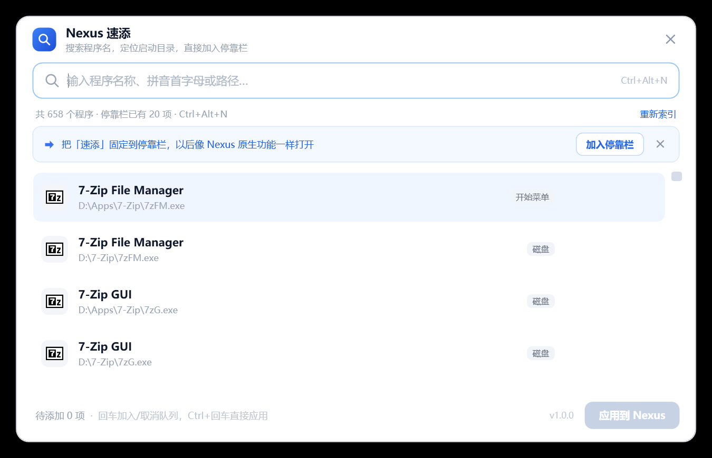

# Nexus 速添 · Nexus QuickAdd

给 [Winstep Nexus](https://www.winstep.net/nexus.asp) 停靠栏用的搜索添加器：输入程序名（中文 / 英文 / 拼音首字母都行），回车就把程序直接加进停靠栏，并自动定位它的启动目录。



它能把「速添」自己固定到停靠栏里，用起来就像 Nexus 自带的一个功能：


- 单文件 exe，**不需要安装**，双击即用
- 自动找到 Nexus 的安装位置（注册表 / 进程 / 常见路径），在别人的机器上也能直接用
- 首次启动自动索引开始菜单、注册表、商店应用、Steam 和磁盘上的绿色软件
- 一键把「速添」加进停靠栏；也能一次挑多个程序，批量加进去

---

## 下载与使用

1. 到 [Releases](../../releases) 下载 `NexusQuickAdd.exe`（Windows 7 SP1 及以上，需 .NET Framework 4.0+，Win10/11 自带）。
2. 确认已经安装并运行 Winstep Nexus。
3. 双击 exe，窗口顶部会出现「把「速添」固定到停靠栏」——点一下就完成整合；以后从停靠栏图标打开即可。

### 操作

| 操作 | 效果 |
| --- | --- |
| 输入 | 实时搜索：中文名、英文名、进程名、拼音首字母（`wx` → 微信、`jsq` → 计算器）、路径片段 |
| `↑` `↓` | 选择 |
| `回车` | 加入待添加队列（再按一次取消） |
| `Ctrl+回车` | 立即应用 |
| `Ctrl+Alt+N` | 呼出窗口（可在配置里改） |
| 行右侧 `目录` | 打开该程序的启动目录 |
| 行右侧 `添加` | 加入队列 |
| `应用到 Nexus (n)` | 备份注册表 → 结束 Nexus → 写入项目 → 重启 Nexus → 等停靠栏就绪 |
| `Esc` | 清空搜索 / 关闭窗口 |

已经在停靠栏里的程序会标上 `已在栏`，不会重复添加（仍可手动再加一次）。

### 索引来源

开始菜单 `.lnk`、注册表 Uninstall 项、`App Paths`、`shell:AppsFolder`（UWP / MSIX）、正在运行的进程、Steam 库、磁盘广度扫描（默认所有本地磁盘，深度 3，限时 3.5 秒）。内置常见中英别名（微信/wechat、腾讯会议/wemeet、网易云/cloudmusic、无畏契约/valorant…），两种叫法都能搜到。

## 配置

首次运行会生成 `%LOCALAPPDATA%\NexusQuickAdd\config.ini`：

```ini
nexus=D:\Nexus\Winstep      ; 自动检测失败时手动指定
roots=C:\;D:\               ; 磁盘扫描根目录，分号分隔
depth=3                     ; 扫描深度 1-5
hotkey=Ctrl+Alt+N
```

把 `settings.txt` 放在 exe 旁边可以覆盖 `roots` / `depth` / `hotkey`（便携用法）。每次写入前的备份在 `%LOCALAPPDATA%\NexusQuickAdd\backups\`，双击 `.reg` 即可还原。

## 工作原理（逆向说明）

Nexus 是 VB6 程序，停靠栏项目不在文件里，而是存放在：

```
HKCU\Software\WinSTEP2000\NeXuS\Docks
  DockNoItems1     最高项目下标（0 起）
  1Path{i}         启动目标（exe 或 .lnk）
  1Label{i}        显示名
  1Type{i}         1 = 程序
  1StartPath{i}    起始目录（可选）
```

三点关键行为（实测）：图标行只在 Nexus 启动时从注册表读取；Nexus 保存设置时会重写整个键，所以外部写入必须等它退出；`WM_CLOSE` 对它无效，只能结束进程再拉起。带参数或商店应用的项目用一个 `.lnk` 承载，和 Nexus 自己拖进去的做法一致。

完整记录见 [docs/nexus-dock-format.md](docs/nexus-dock-format.md)。

## 构建

```powershell
# 需要 .NET Framework 4.x（系统自带 csc，不用装 SDK）
powershell -ExecutionPolicy Bypass -File build.ps1
# 产物：dist\NexusQuickAdd.exe
```

源码结构：

```
src\AppInfo.cs      版本与产品信息
src\Program.cs      入口、单实例、--install-dock
src\MainWindow.cs   窗口逻辑、搜索、队列、应用、动效
src\NexusEnv.cs     Nexus 探测 + 配置
src\NexusDock.cs    注册表读写、备份、重启、自我安装
src\Indexer.cs      七类索引来源
src\Model.cs        数据模型、拼音首字母、排序打分
src\Native.cs       快捷键、图标、快捷方式 COM
ui\main.xaml        界面（运行期解析，内嵌进 exe）
```

CI：`.github/workflows/build.yml` 在 push / PR 时构建并上传产物，打 `v*` 标签时自动生成 Release。

## 已知限制

- 应用改动需要**重启一次 Nexus**（约 2 秒，停靠栏会闪一下）——这是 Nexus 只在启动时读配置决定的。
- 只处理第 1 个停靠栏（`DockNoItems1`）。
- 只做「添加」，不做删除 / 排序；删除请用 Nexus 自己的右键菜单。
- 磁盘扫描是启发式的（文件大小、版本信息、文件名黑名单），个别绿色软件可能扫不到，可以改用开始菜单或直接搜路径。
- 应用时会强制结束 Nexus，正在拖动排序这种半途操作会中断（Nexus 对设置的改动是即时落盘的，正常使用不会丢配置）。

## 免责声明

本项目是非官方的第三方工具，与 Winstep Software Technologies 无关联。它只读写 Nexus 自己使用的用户级注册表配置，不修改、不重打包 Nexus 的任何二进制文件。使用前建议先备份停靠栏配置（工具每次写入前也会自动备份）。

## English

A search-and-add companion for the Winstep **Nexus** dock: type a program name, press Enter, and the program lands on your dock with its working directory resolved. It detects the Nexus installation automatically, indexes Start Menu / registry / UWP / Steam / portable apps on first run, and can pin itself to the dock so it feels like a built-in feature. Single portable exe, no installer, .NET Framework 4.0+. Not affiliated with Winstep.

## License

[MIT](LICENSE)
